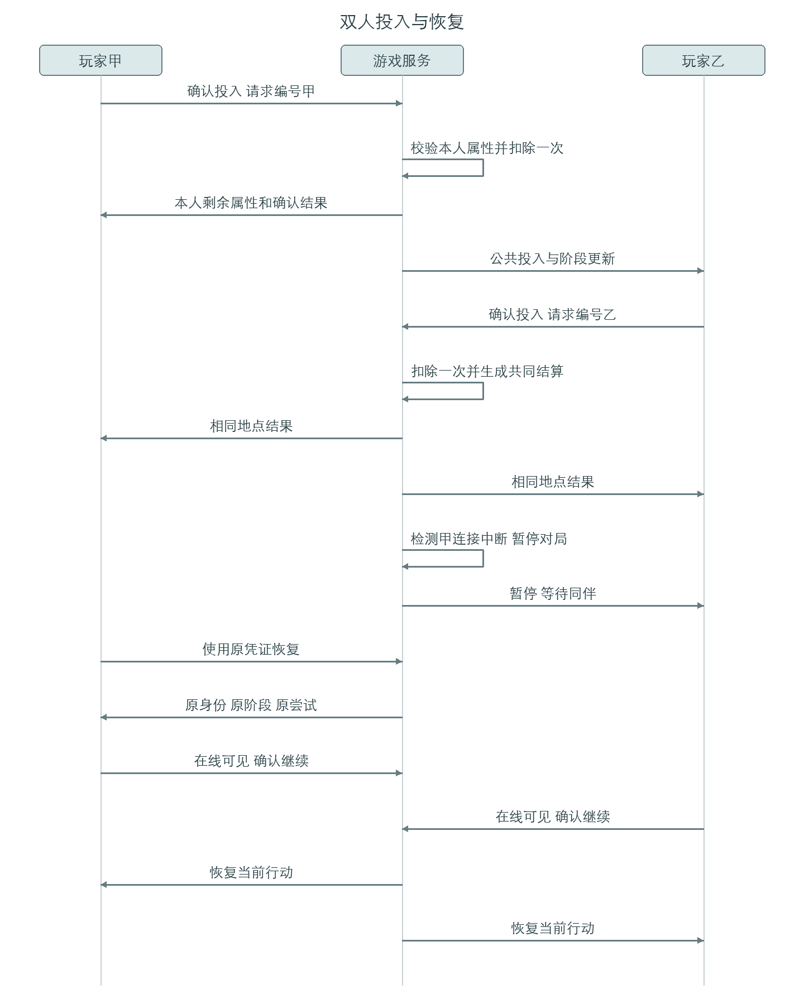
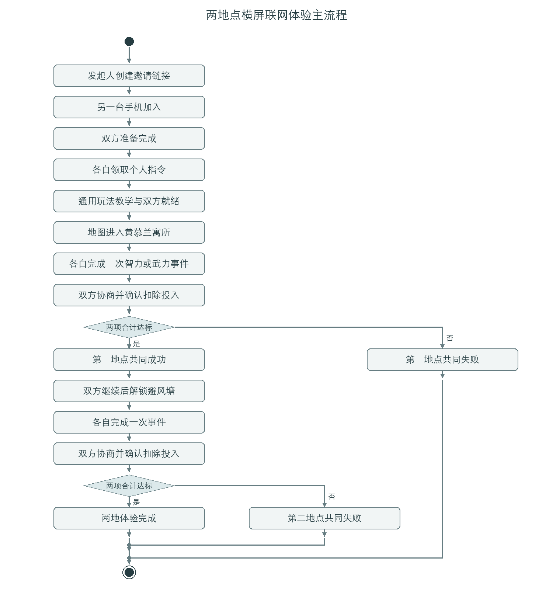
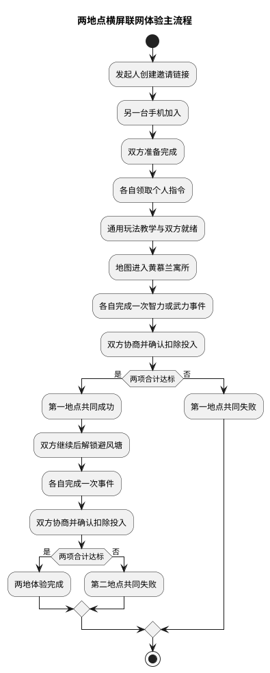
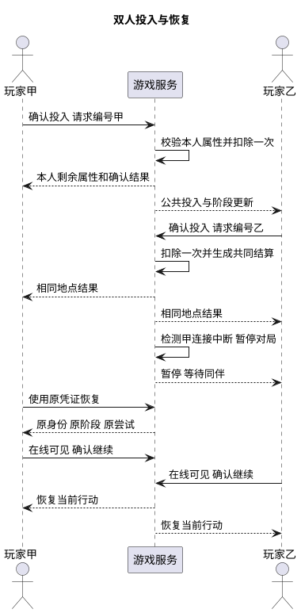

# 暗线同行者 两地联网横屏体验版 产品需求文档

文档版本：第一版修订一　编制日期：2026年11月4日　交付周期：启动日起连续七天

本文用于产品、Figma 设计、前端开发、后端开发和测试共同实施。目标是交付可在两台手机横屏联网游玩的两地点完整体验。五地点地图是主要操作入口；本期只开放前两处，通关后显示体验完成，不提前触发完整七日故事的最终背叛。正文中的数值和剧情为本期执行基线，历史背景与虚构情节分别标明。

## 1. 项目背景

### 1.1 需求简介

以黄慕兰相关抗日救亡经历和香港文化名人大营救网络为历史背景，制作双人合作、个人身份隐藏的移动端横屏网页游戏。玩家在地图中进入地点，阅读剧情，选择智力或武力小游戏获得属性，再协商并扣除各自投入，合力完成转移任务。

### 1.2 业务诉求

验证三件事：城市与区域地图能否形成地点探索感；真实小游戏能否支撑智力、武力资源获取；双人是否会围绕“共同通关”和“保存自身实力”产生讨论。首周同时验证两台真实手机的数据同步、秘密身份隔离、扣除一致性和断线恢复。

Figma 是高保真交互原型和设计交付物，不替代可运行前端。前端开发根据原型实现页面与小游戏；后端由 Codex 辅助编写并提供业务服务，双方从第一天按共同业务契约并行工作。

### 1.3 本期范围与版本边界

| 范围项 | 本期交付 | 本期不交付 |
| --- | --- | --- |
| 使用方式 | 两台手机、横屏网页、邀请链接、双人准备 | 账号、匹配、房间列表、聊天、观战 |
| 地图 | 五个地点均可见，前两处开放，后三处标记后续内容 | 自由行走、真实导航、多个地图系统 |
| 地点内容 | 九龙黄慕兰寓所、香港铜锣湾避风塘 | 惠阳／惠州、曲江、桂林的可玩内容 |
| 小游戏 | 一套智力单选解谜框架、一套武力点击反应框架；各配两个地点内容，共四项事件 | 独立开发四套小游戏引擎、实时动作战斗 |
| 角色 | 两名虚构玩家角色，每人一张立绘、一个头像、两种表情 | 多角色选人、换装、骨骼动画、历史人物叛徒化 |
| 属性 | 每人一套智力与武力；获得、协商投入、实际扣除、剩余值继承 | 另一套永久属性、天赋树、背包和装备 |
| 联网 | 创建邀请、加入、准备、同步、身份隔离、一次性结算、重连 | 开放式实时多人战场、跨设备账号找回 |
| 终点 | 地点一失败、地点二失败、两地体验完成 | 七日最终泄密选择、枪决与双骰对决 |
| 制作成果 | Figma 原型、可运行前端、业务接口、剧情和素材、验收记录 | 仅能点击展示而不能真实联调的静态原型充当成品 |

### 1.4 时间与地点口径

“七天”首先指本次开发周期；完整游戏保留七个行动日的方向，本期只实现两个可玩行动节点，对应前两个地点。截图提供五个地点，不能因此把五处硬凑成七处。完整七日与五地点的对应关系进入后续版本设计，不影响本期两地闭环。

历史时间以“1941年冬至1942年初”作为背景。章节之间允许叙事跳时；地图连线表示营救网络与章节关系，不表示黄慕兰本人的连续逃亡路线，也不把跨海移动表现成一步步行。界面显示“第一章”“第二章”，不显示未经核定的具体日期。

### 1.5 历史与改编边界

| 内容 | 处理要求 | 依据与限制 |
| --- | --- | --- |
| 黄慕兰寓所与林庚白遇害 | 作为危险环境背景，采用文字叙述；不把历史遇害者设为可救活的胜负对象 | 《黄慕兰自传》试读本记载林庚白于12月19日晚自其寓所后门外出遇害；书内页码184至185，见附录资料一 |
| 铜锣湾避风塘与转移 | 保留分批集结、掩护登船的功能；船只、口令、行动步骤由游戏改编 | 广东省委统战部转载的营救报道记载1942年1月9日相关渡海转移，见附录资料二 |
| 两地点连接 | 以虚构交通员执行两个任务片段串联 | 不宣称两章为同一真实人物的精确行程 |
| 玩家身份 | 情报员与叛徒都由虚构角色承担，身份与角色外貌随机独立 | 不将黄慕兰或其他真实人物设为随机叛徒；游戏失败不改写历史结局 |
| 地图与建筑 | 做示意地图与年代氛围，不复刻未经考证的准确门牌、海岸线或建筑内部 | 原图中的地点用途为创作输入；具体场景和小游戏均标为艺术改编 |

## 2. 业务流程简述

### 2.1 双人主流程

玩家甲打开横屏游戏 → 点击“开始双人游戏” → 获得邀请链接 → 玩家乙打开链接并加入 → 两人分别准备 → 系统分配身份 → 各自在自己的手机确认个人指令 → 阅读通用玩法 → 两人就绪 → 地图开放黄慕兰寓所 → 进入剧情 → 各自选择一个事件并完成小游戏 → 结果增加对应属性 → 双方协商投入 → 各自确认扣除 → 两项合计达标 → 共同结算并解锁铜锣湾避风塘 → 重复第二地点流程 → 显示“两地体验完成”并回看记录。

任一地点投入不足，双方进入同一个失败结局；任一玩家断线，当前对局暂停并保留进度；恢复后继续原状态。第二地点成功属于本期体验完成，不是完整故事的最终好结局。

### 2.2 角色视角

| 角色 | 可见内容 | 不可见内容 |
| --- | --- | --- |
| 情报员 | 自己的合作指令、公共剧情、双方现有属性、公开投入、公共进度 | 对方身份、叛徒指令、未来泄密按钮、另一台手机的未提交答案 |
| 叛徒 | 自己的叛徒指令、相同公共内容、后续版本目标说明 | 对方未提交答案、未产生的判定结果 |
| 房间发起人 | 邀请链接、双方准备状态、退出并结束当前房间的操作 | 对方秘密身份；发起房间不授予剧情或属性修改权 |
| 加入者 | 自己的加入与准备状态、自己的恢复凭证 | 发起人的私密凭证；不能通过邀请链接接管已占用座位 |

### 2.3 核心规则与数值

| 项目 | 本期基线 |
| --- | --- |
| 初始属性 | 两人均为智力5、武力5，身份不改变初始值 |
| 行动次数 | 每人每地点一次有效事件尝试，只能选智力或武力；双方可选同一种 |
| 事件结果 | 智力事件三题，完成度＝答对题数÷3；增加智力＝向下取整后的10×完成度，即0、3、6、10 |
| 武力结果 | 十次有效目标机会，完成度＝命中次数÷10；增加武力＝命中次数，即0至10 |
| 属性口径 | 只有现有智力、现有武力；事件仅增加对应项，任务投入直接扣除，没有另一套回合属性 |
| 第一地点需求 | 双方合计智力5、武力5 |
| 第二地点需求 | 双方合计智力6、武力4；继承第一地点剩余属性 |
| 投入限制 | 每项为0至本人对应现有值的整数；可同时投入两种；确认后不可撤销 |
| 通关条件 | 两人都已投入并确认，且两项合计均不小于要求；不再额外随机判失败 |
| 超额与不足 | 超额不退还；不足立即共同失败。先显示实时合计和风险提示，避免误以为零投入会自动补齐 |
| 知情范围 | 现有属性、已提交投入和完成事件类型公开；身份仅本人可见 |
| 事件小游戏替换 | 原演示中的随机完成度退出本期正式验收；不以随机结果替代未完成的小游戏 |

### 2.4 状态定义

| 状态 | 允许操作 | 进入下一状态的条件 |
| --- | --- | --- |
| 等待同伴 | 复制邀请、加入、退出 | 两个座位均被有效玩家占用 |
| 等待准备 | 双方各自准备或取消准备 | 两人都准备完成，身份仅分配一次 |
| 个人指令 | 本人查看并确认；可阅读通用玩法 | 两人均完成指令确认与玩法就绪 |
| 地图待进入 | 当前点位可进入；旧点位可回看 | 两人均确认进入同一当前地点 |
| 地点剧情 | 本地逐段阅读、确认已读 | 两人均读完开场，开放事件 |
| 事件选择与进行 | 每人独立选择及完成一次事件 | 两人的事件都已结算 |
| 协商投入 | 各自编辑与确认自己的投入 | 双方都提交，系统只结算一次 |
| 地点结算 | 双方查看成功或失败 | 成功且双方继续则下一地点；失败则结束 |
| 体验完成 | 回看公共记录、返回开始界面 | 不自动进入第三地点 |
| 暂停重连 | 查看恢复状态、退出 | 原玩家恢复连接、返回可见前台后继续；屏幕方向不影响对局状态 |

## 3. 详细功能需求说明

### 3.1 全局界面与横屏规范

位置：所有页面。目标：让两台手机的横屏操作一致，保证地图、剧情和触控可读。

#### 3.1.1 界面元素与展示规则

• Figma 主画板采用844×390逻辑尺寸，另给出667×375与932×430适配示意。采用安全区内布局；刘海、圆角与底部手势区域不承载必要按钮。支持目标设备为近三年常用的苹果手机系统浏览器与安卓手机系统浏览器；第一天锁定至少各一台实机型号和系统版本。微信内置浏览器作为兼容检查项，不默认承诺所有版本可玩。

• 横屏下地图是持续可见的主操作区，占安全区宽度约55%至60%；右侧任务和操作面板占40%至45%，面板内部滚动。地图不随面板滚出屏幕。小游戏使用右侧完整面板，禁止覆盖或替换整张地图。地图触点不小于44×44逻辑像素，主要确认按钮高度不小于44。

• 正文建议14至16逻辑像素，辅助信息不小于12；剧情自然换行，不截断关键内容。地点名最多两行，超出在详情显示全名；属性只显示非负整数，缺失显示“—”，不得用0掩盖加载失败。静态按钮使用本文双引号内文案，动态值均来自该局当前状态。

• 页面只有有限清单：五个地图点、两名玩家、两地点记录；直接完整加载，无分页、无限滚动、下拉刷新。空记录显示“尚无行动记录”；加载中显示骨架占位，失败提供“重新加载”。装饰动画可关闭，音效默认静音，声音不作为唯一判定线索。

#### 3.1.2 交互逻辑与状态流转

• 通用操作生命周期：初始化时读取当前局和本人权限；默认只开放当前阶段可用按钮；单击触发；执行中按钮显示“处理中…”并禁止重复提交；失败恢复操作并显示具体原因；成功采用服务端返回状态更新，不提前发放资源或跳关。

• 游戏始终采用横屏布局。设备转为竖屏时，仍保留原横屏画布与布局关系，不切换竖屏排版、不跟随方向重新适配，也不弹出阻断遮罩、不退出游戏。两人均在线并进入可见前台即可启动小游戏，屏幕方向不作为启动条件。转回横屏后继续原界面，身份、地点、属性、题目、输入草稿与进度保持不变。

• 切后台、来电导致页面不可见或连接中断时报告暂停；单纯横竖屏切换不报告暂停、不停止小游戏计时。发生实际暂停时，对方显示“同伴暂时离开，等待恢复”。计时仅扣除系统已确认的有效进行时长，暂停和恢复由同一局统一确认，规则见3.12。触控事件只记一次，不同时叠加鼠标与触屏造成的双次命中。

#### 3.1.3 异常与系统边界

• 屏幕方向变化只影响设备视窗，不重建游戏场景、不清除输入或当前谜题，也不触发退房、重连、重新分配身份或退出。若旋转同时导致页面进入后台或连接中断，只按实际后台或断线原因处理。图片加载失败保留轮廓占位、角色名称和文字功能，并提供重试；必要交互素材未就绪不得消耗行动点启动事件。

• 弹窗有半透明遮罩，关键确认不允许点击遮罩关闭；帮助说明允许显式关闭。优先级为连接或后台暂停＞退出与销毁确认＞投入确认＞剧情提示＞轻提示。高优先级出现时冻结低优先级，不提交后者；恢复后重新校验再显示。

• 无声音、无震动或不支持全屏时仍能完成全部玩法；无需摄像头、麦克风、定位或传感器权限。浏览器缩放与系统字号变化不得遮挡确认按钮。

### 3.2 游戏开始与最小联网入口

位置：游戏链接首页。目标：通过邀请链接让两个真实玩家进入同一局，不引入账号和房间大厅。

#### 3.2.1 界面元素与展示规则

• 开始页展示游戏名“暗线 同行者”、地图氛围背景、“开始双人游戏”“玩法介绍”“继续当前对局”。只在当前设备有有效本人恢复凭证时展示继续入口；没有凭证不显示无效按钮。

• 发起后显示“等待同伴加入”、完整邀请链接、“复制邀请链接”“分享指引”“退出当前对局”。链接仅标识可加入的局，不携带发起人的私密身份、恢复凭证或当前题目答案。不做房间码输入、房间列表、好友系统和自动匹配。

• 加入页展示“加入这次行动”“加入游戏”；加入完成后显示玩家甲、玩家乙、双方连接状态及“准备”。玩家甲默认发起人，玩家乙默认加入者；两人立绘绑定座位，身份随机独立分配。

#### 3.2.2 交互逻辑与状态流转

• “开始双人游戏”：初始化无进行中的有效局；默认可用；单击创建；处理中置灰并显示“正在创建…”；失败显示“创建失败，请重试”；成功显示邀请页。若本设备已有进行中的局，先提供“继续原对局”与“结束原对局并新建”，不悄悄覆盖。

• “加入游戏”：初始化校验邀请仍有效且有空位；默认可用；点击占用玩家乙座位；处理中显示“正在加入…”；满员、失效或凭证冲突时停留错误页；成功进入双人准备。并发加入只允许一个成功，其余显示“本次行动已有两名玩家”。

• 复制失败时选中完整链接，显示“请长按复制邀请链接”；不申请通讯录权限，也不自动向他人发送消息。接收者在同一邀请链接内加入，分享接收对象由玩家自行决定。

• “准备”只修改本人状态；双方准备齐后自动分配一次身份并进入各自档案。未齐时可取消；已正式开始后准备状态固定，不重新分配身份。任何一端连点或刷新均不能创建第二个角色。

#### 3.2.3 异常与系统边界

• 等待加入超过15分钟且没有有效交互，邀请失效；结束的局不再接受新玩家。满员不转为观战。原玩家重连依靠本人恢复凭证，不凭邀请链接接管原座位。

• 不支持内置浏览器时显示“请在手机浏览器中打开”，保留原邀请链接；打开外部浏览器会形成新的设备会话，加入前应说明恢复凭证不会自动跨浏览器迁移。退出后的明确后果见3.12。

### 3.3 角色档案与隐藏身份

位置：双人准备完成后自动进入本人档案；本局菜单中的“查看个人指令”。目标：叛徒知情，情报员只收到任务，不直接被告知存在叛徒。

#### 3.3.1 界面元素与展示规则

• 两位虚构人物暂名“林舟”“顾宁”，均为营救网络中的交通员；最终姓名可由编剧替换，不影响身份。角色立绘、头像和昵称为公共；身份文字、秘密目标为私密。立绘与身份不得固定绑定，不能通过衣色或界面颜色识别叛徒。

• 情报员私密文案：“你的任务是与同伴完成转移行动。利用现有智力与武力，合理分担任务消耗，把联络资料安全交到下一站。封签与记录上的异常，也值得留意。”标题为“个人指令”，身份称谓为“交通员”，不出现“忠诚者”“叛徒”“背叛”“泄密对决”等规则。

• 叛徒私密文案：“你另有秘密任务。先与同伴完成转移，谨慎决定为共同任务付出多少，保存行动实力。本次只开放前两个地点，不会触发最终抉择。完整故事中，你可在最终阶段选择泄密并以剩余属性争取对决优势；不泄密或对决失败将进入被枪决结局。”后台按本人身份下发，不把两套文案都交给客户端再隐藏。

#### 3.3.2 交互逻辑与状态流转

• 身份初始化时只分配一次，一局恰有一名叛徒；两人均显示“查看个人指令”，点击后仅本人可见；按钮进入加载状态，失败可以重试读取原指令；成功后“我已记住”关闭档案并标记已确认。

• 对方只能看到“同伴正在阅读／已确认”，不能看到阅读时长对应的内容类型、身份图标或分支按钮。返回菜单再看档案不改变确认状态、不重分身份。退出私密页立即移除屏幕文字，切后台先遮挡私密页。

• 所有公共玩法页、邀请卡、开始页、资源日志、地图提示及推送文案不得剧透身份系统。剧情只通过可多义解读的封签、数字和记录暗示，不直接指认任一玩家。

#### 3.3.3 异常与系统边界

• 玩家甲请求玩家乙档案、其他局档案或修改身份的请求均拒绝；错误返回“无法查看该个人指令”，不返回对方实际身份。服务端公共状态、错误详情和前端调试日志均不得夹带秘密内容。

• 本人凭证失效时回到恢复失败页，不通过房间链接重新随机身份。为测试提供的指定身份入口仅用于测试环境，不出现在生产邀请或玩家菜单。

### 3.4 游戏玩法介绍

位置：开始页“玩法介绍”、首次指令确认后、地图菜单。目标：让玩家理解单套属性、事件收益与扣除规则，不暴露结尾。

#### 3.4.1 界面元素与展示规则

• 三页教学：第一页“从地图进入地点”；第二页“每人一次事件，获得智力或武力”；第三页“商量各自投入，确认后会扣除”。每页使用两名角色、地图点位、数值变化示例。第三页示例：原有智力8，投入3，剩余5。

• 显示“上一页”“下一页”“了解，开始行动”及页码。页面文案完整换行，无横向文字滚动；图示缺失时用文字例子兜底。教学中不出现角色间最终对决、隐瞒身份或胜负收益说明。

#### 3.4.2 交互逻辑与状态流转

• 首次阅读不可跳过核心扣除页；再次查看可直接关闭。每端独立翻页，互不抢进度；完成后本人进入“等待同伴就绪”。双方就绪才共同打开地图。

• 教学里的按钮和数值仅为演示，不调用真实加点或投入；操作按钮默认可用，切页防连击，失败重试读取原教学，不消耗行动点。

#### 3.4.3 异常与系统边界

• 刷新后恢复已确认状态，不让另一端重新教学。离开教学再回来保留本端页码；断线优先展示暂停状态，恢复后继续。教学完成标记与个人身份确认标记分别保存，不能互相代替。

### 3.5 地图主界面与地点解锁

位置：完成就绪后进入的主要游戏界面。目标：地图持续承载游戏操作，体现五处地点的空间关系与两处可玩范围。

#### 3.5.1 界面元素与展示规则

| 地点 | 初始展示 | 本期用途 |
| --- | --- | --- |
| 九龙 黄慕兰寓所 | 当前可进入，编号一 | 第一章，危险预警、整理联络线索、掩护出发 |
| 香港 铜锣湾避风塘 | 锁定，注明“完成前一地点后开放” | 第二章，识别登船信息、掩护转移 |
| 惠阳／惠州 | 可见且灰显，注明“后续内容未开放” | 保留营救接应与转交情报方向 |
| 曲江 今韶关 | 可见且灰显，注明“后续内容未开放” | 保留接待与任务分配方向 |
| 桂林 | 可见且灰显，注明“后续内容未开放” | 保留后方安全区方向 |

• 地图采用区域示意：香港和九龙为可辨认的局部，惠阳／惠州、曲江、桂林以延伸区域节点表示，明确“营救网络示意，非精确导航”。不把五处不同尺度地点画成同一街区。香港与九龙之间必须可看出海域阻隔。

• 当前地点使用强调色及“可行动”标签；完成地点显示对勾；锁定与未制作地点分别用不同文字，不能只靠颜色。玩家头像显示在当前共同地点，不制作自由拖动角色和移动寻路。右侧显示章节、剧情、目标与双方现有属性。

#### 3.5.2 交互逻辑与状态流转

• 初始化从对局状态读取开放点位；单击当前地点打开侧栏并显示“进入地点”；本人确认后显示“等待同伴进入”；两人均确认才进入开场剧情。一个人点地图不能替另一人启动计时小游戏。

• 第一地点成功后必须双方点击“继续”，系统一次性开放第二地点，当前标记移动过去。旧地点可回看剧情与公开结果，不提供重新刷属性入口。回看仅影响本人侧栏，不切换对方地点或公共进度。

• 未开放地点点击后显示原因：“请先完成黄慕兰寓所”或“本次体验暂未开放”；无加载、无扣费、无隐式跳转。返回当前地点可恢复本人的事件、投入草稿或结算页。

#### 3.5.3 异常与系统边界

• 服务端未确认通关前，地图不得预先显示第二地点可进入。解锁请求重复、乱序或由另一端同时触发时仍只前进一次。地图素材失败使用五节点示意图兜底，不影响必要入口。

• 地图保持可见优先于装饰动画；在最小横屏尺寸下右侧面板滚动，点位和关闭键不得被遮挡。回看不能泄露对方身份或未提交谜题答案。

### 3.6 前两个地点的剧情内容

位置：地点进入后、小游戏前后与通关结算。目标：两处形成可理解的章节衔接，并为四项事件提供自然动机。

#### 3.6.1 界面元素与展示规则

• 剧情采用对话框与少量叙述，单段建议20至70字，最多四行；完整文本自然换页，不以省略号隐藏关键信息。每处开场四段、事件前各一段、事件后各一段、通关两段、失败两段。以下为可直接替换占位稿的基线；玩家角色名随座位资料代入，不插入本人身份。

| 第一地点段落 | 展示文本或内容 |
| --- | --- |
| 开场一 | “九龙的街道传来零散枪声。寓所里，几只行李箱还没有合上。” |
| 开场二 | “这里曾为流离中的文化人士提供落脚处。后门外的危险，已不只是传闻。” |
| 开场三 | 林舟：“先把联络线索整理出来。另一人盯住巷口，我们不能一起困在这里。” |
| 开场四 | 顾宁：“信封边缘有两道胶痕。先核对口令，别把错的东西带走。” |
| 智力事件前 | “联络笺把三个符号对应到三个字。按笺上的提示辨认信息，不需要背诵历史知识。” |
| 武力事件前 | “巷口的安全窗口很短。看准通行信号，及时点击，协助同伴转移物资。” |
| 事件后 | 动态显示完成度和对应属性获得值；叙述为“线索已整理／物资已转移一部分”，不把低分写成历史人物死亡 |
| 通关一 | “联络资料和随身物资已完成整理。你们把剩余资源记在各自的行动册上。” |
| 通关二 | “一段时间后，新的联络指令送达：前往铜锣湾避风塘，协助下一批人员转移。” |
| 失败 | “线索核对与掩护准备未能同时完成。你们错过了安全窗口。”／“本次行动中断。史实中的营救仍由其他交通线继续。” |

| 第二地点段落 | 展示文本或内容 |
| --- | --- |
| 开场一 | “夜色下，铜锣湾水面泊着几只小艇。岸边的人压低声音，等候分批登船。” |
| 开场二 | “转移网络依靠联络、伪装和接力，不是一张能照着走到底的单一路线图。” |
| 开场三 | 顾宁：“先核对船号和接头凭据，再把人和行李分批送过去。” |
| 开场四 | 林舟：“行动册上的一个编号被改过。我们先把眼前这批人送到安全处。” |
| 智力事件前 | “阅读船期和联络卡，从三组选项中找出符合条件的安排。” |
| 武力事件前 | “利用信号间隙协助登船。每次出现通行标记时点击，避免误触警戒标记。” |
| 通关一 | “最后一只行李被递上船。岸上的联络人收起手势，你们完成了这段转移任务。” |
| 通关二 | “前方还有惠阳、曲江与桂林的消息。本次体验到此结束，故事仍在继续。” |
| 失败 | “登船安排和现场掩护未能衔接，安全窗口关闭。”／“本次行动中断，请重新配合。” |

• 开始页及史实说明页标注：“以历史营救网络为背景，玩家角色、对话、任务与失败分支为虚构改编。”历史人物不承担小游戏成败，不以枪杀真实人物作奖励或惩罚画面。

#### 3.6.2 交互逻辑与状态流转

• 本人点击“下一段”推进，不自动跨越未读段；逐字显示时首次点击显示全句，再次点击翻段。开场阅读不计时、不消耗行动点；本人读完显示“已读完，等待同伴”，两人均读完才开放事件选择。

• 两人各自的事件后结果独立展示；公共通关与失败文本统一。历史说明可从地图菜单回看，阅读不阻塞对方已完成的操作。

#### 3.6.3 异常与系统边界

• 剧情配置缺失时显示“内容暂时无法加载，请重试”，不得跳过到不存在的小游戏。恢复原段落，不重复消耗或发奖励。开发稿必须保留剧情版本，避免一局中途热更新改变答案或规则。

### 3.7 智力解谜小游戏

位置：当前地点事件选择中的智力入口。目标：通过现场信息推理解答增加智力；两地点复用同一套三题单选框架。

#### 3.7.1 界面元素与展示规则

• 开始前显示事件名、线索卡、三题说明、“总时长60秒”“答对越多，获得智力越多”和“开始”。每题三个选项，触控单选，选项完整换行；已选答案有文字及勾选标记。倒计时位于固定位置，剩余10秒有颜色与文字提示，不依赖音效。

| 地点与题号 | 现场线索与问题 | 三个选项 | 正确答案 |
| --- | --- | --- | --- |
| 寓所一 | 线索：“灯＝竹，窗＝海，门＝舟。”问：“窗对应哪个字？” | 竹／海／舟 | 海 |
| 寓所二 | 线索：“联络口令按灯、窗、门排列。”问：“哪组顺序正确？” | 竹海舟／海竹舟／舟海竹 | 竹海舟 |
| 寓所三 | 线索：“有效联络笺同时有圆印和双折角。”问：“该选哪张？” | 圆印单折／方印双折／圆印双折 | 圆印双折 |
| 避风塘一 | 线索：“一号船去西岸，二号船去北岸，三号船去东岸。”问：“要到北岸选哪船？” | 一号／二号／三号 | 二号 |
| 避风塘二 | 线索：“先人员、再行李、最后联络袋。”问：“第二批是什么？” | 人员／行李／联络袋 | 行李 |
| 避风塘三 | 线索：“通行凭据必须船号二且带圆印。”问：“哪张可用？” | 二号方印／一号圆印／二号圆印 | 二号圆印 |

• 两组题均为虚构联络谜题，不当作历史考据。三题同时可回看线索，允许在60秒内修改选择，不设置必须记住的真实人名、日期。题目选项由内容配置决定，不随机改变玩家所见线索。

#### 3.7.2 交互逻辑与状态流转

• 初始化仅本人有行动点且素材已加载；默认显示预备页；点击“开始”后服务端确认尝试成立并消耗本人本地点行动点；处理中按钮置灰；失败未成功建立尝试则不消耗；成功后开始60秒有效计时。

• 单选点击立即标记本地选择并同步保存草稿。点击“提交答案”进入确认；未答完明确提示“还有未作答题目，提交后按错误计分”，可返回继续；完成提交后禁用所有选项。超时自动提交已保存答案，未选题按错误计。

• 计分只在系统接受本次结果后显示：答对数为0、1、2、3，对应完成度0%、33%、67%、100%，用于展示时四舍五入；奖励按精确答对数计算为0、3、6、10，不能用展示百分比再反推。仅增加本人智力一次，武力不变。

#### 3.7.3 异常与系统边界

• 已开始的事件不能通过返回地图换成武力、刷新换题或重新尝试；返回地图只收起面板，再进入恢复原题与剩余时间。放弃本次事件需二次确认，按当时已保存答案结算，不退行动点。

• 正确答案不得在未结算前以答案字段下发客户端。失败重试提交使用同一尝试和同一请求编号；超时自动提交与手动提交并发只接受一个最终成绩。断线、切后台的计时处理统一按3.12，不直接重开60秒；单纯横竖屏切换保持原倒计时继续运行。

### 3.8 武力反应小游戏

位置：当前地点事件选择中的武力入口。目标：以触控反应表现掩护和转移能力，不增加独立战斗系统。

#### 3.8.1 界面元素与展示规则

• 两地点复用同一框架：寓所外观为“巷口通行信号”，避风塘外观为“登船通行信号”。屏幕固定三个可点击区域，单次只在一个区域显示圆形“通行”目标。其余为灰色“警戒”区域；文字和形状同时区分，不只用红绿。

• 一轮十次机会。每次目标显示1200毫秒，间隔800毫秒，总有效时长19.2秒；开场3秒倒数不计分。显示机会序号、命中数、计时状态；目标区域不小于56×56逻辑像素，避开地图、手势区与主要返回键。

#### 3.8.2 交互逻辑与状态流转

• 与智力事件使用相同开始生命周期：服务端成功建立尝试后扣行动点；收到可开始状态再倒数。目标位置和每次机会编号来自本次固定序列，刷新恢复同一序列，不重新抽取更容易的关卡。

• 目标显示期内第一次点击正确区域记一次命中，本机会立即结束；点击错误区域则本机会记未命中，不再允许补点；未点击直到消失记未命中。间隔期点击不计分、不影响下一机会。一次机会不接受多个命中，多指触控只接受首个有效触点。

• 第十次完成后自动提交；完成度为命中数×10%，增加武力为命中数0至10，仅结算一次。前端只提交机会与操作记录，奖励值由服务端按规则返回，客户端不得直接指定“武力＋10”。

#### 3.8.3 异常与系统边界

• 暂停恢复后继续剩余有效窗口；不能重放已经结束的机会。因系统确认暂停而中止的当前机会保留未用时长，不额外赠送命中。网络异常造成结果未确认时显示“正在确认结果”，不重复开始或由前端直接发奖。

• 浏览器卡顿不自动算命中。开发与测试必须在目标实机评估触控延迟；若连续十次事件展示不稳定，调整统一时间配置并整体验证，不能让两位玩家采用不同计分规则。纯随机得分不算完成本模块。

### 3.9 属性展示与协商投入

位置：两个事件结果均确认后，地图右侧切为“协商投入”。目标：让两人分担固定任务成本，并清楚看到个人付出与剩余实力。

#### 3.9.1 界面元素与展示规则

• 显示本关需求、双方现有智力与武力、已确认的投入合计、本人两项数字输入、“确认投入”。本人可编辑自身输入，对方只读；对方未确认的草稿不公开。页面提示：“确认后立即扣除，不能修改；超额投入不退还。”

• 每项输入配减一、加一按钮，默认0，范围0至本人对应现有值。输入框使用数字键盘，不自动聚焦抢占屏幕。输入草稿变化时显示“投入后剩余”预览，预览与当前值明确区分；服务端确认前现有值不变。

• 合计显示“已投入智力{合计}／{要求}、武力{合计}／{要求}”；合计来自双方已确认投入。对方尚未确认显示“同伴正在考虑”，不能以0假装已提交。

#### 3.9.2 交互逻辑与状态流转

• 输入时校验只允许整数格式；失焦与提交再次校验。空值可暂时保留，提交时阻断并显示“请填写投入数量”；负数、小数、科学计数、字母均提示“请输入非负整数”；超出现有值提示“投入不能超过现有属性”。最大业务值暂设999，事件与服务端均不得生成超出范围的属性。

• 单击确认打开汇总弹窗：“本次投入智力{甲}、武力{乙}；确认后剩余智力{丙}、武力{丁}。”取消保留草稿；点击“确认扣除”进入处理中，拒绝连点；失败无确认时读取最新状态再提示重试；成功后显示“已投入并扣除”，输入只读。

• 若本人是第二个提交者，且提交后仍不满足需求，确认弹窗额外明确：“当前投入将使本关失败，双方对局结束。”允许返回修改，也允许主动确认；系统不得暗自增加或改写投入。两人同时提交时以系统最终接受结果为准，未能提前显示的不足结果仍按规则结算。

• 扣除与本人投入记录是同一笔业务：原值减去投入值。本人提交确认后即使另一人未确认，也不可再次扣除或撤回。双方确认齐后自动检查两项总量，并只生成一次共同结算。

#### 3.9.3 异常与系统边界

• 草稿不因对方提交、地图回看或同步刷新而清空。请求期间不允许本端修改；重复请求返回第一次结果。另一标签页使用相同座位时提示“当前身份已在另一页面打开”，仅保留一个可操作页面。

• 过期阶段、越权修改对方、余额不足或提交版本落后的请求均拒绝，不做部分扣除。返回最新状态后保留可用草稿，标记需要重新确认，不能自动提交旧金额。

### 3.10 地点结算与体验终点

位置：双方投入完成后自动显示。目标：统一两端的胜负与地图解锁，不把本期终点误写成完整游戏结局。

#### 3.10.1 界面元素与展示规则

• 成功页显示两人投入明细、合计与要求、扣除后属性及“继续”。第一地点成功文案“联络准备完成，下一站铜锣湾避风塘”；第二地点成功文案“两地体验完成，后续路线尚未开放”。

• 失败页显示“本次行动中断”、不足项、双方最终属性及“返回开始界面”；不显示任何真实历史人物被杀画面，不公开隐藏身份。游戏结束不复活已花费属性，也不提供本关重刷按钮。

• 记录仅两条，按地点顺序完整显示；空态为“尚无已完成地点”。含事件名称、完成度、获得值、投入值、通关结果，不包含对方私密指令、未选答案或秘密身份。

#### 3.10.2 交互逻辑与状态流转

• 结算时系统接受双方投入，计算并保存共同结果，两端读取同一份结果。第一地点两人均点击“继续”后才把共同当前地点切到第二地点；已继续者显示等待，不替另一端跳页。

• 第二地点成功后仅显示本期完成页与记录回看。返回开始不自动销毁另一端数据；发起新一局需要再次创建邀请、让双方重新准备。完整七日结尾、最终泄密、枪决、两骰及属性重掷仅在制作资料附录中保留，不在情报员客户端公共教学出现。

#### 3.10.3 异常与系统边界

• 同一局同一地点只允许一次结算与一次解锁。结算期间断线，重连读已保存结果；不能重新计算为另一种结局。某端渲染失败不阻止另一端查看结果，但双方继续条件仍需满足。

• 结算页刷新不重播会影响数值的操作。只有公开档案可以回看，不从旧地点进入小游戏。后三处点位保持“后续内容未开放”，不得误用第二地点成功状态全部解锁。

### 3.11 角色立绘与美术素材

位置：开始页、地图、剧情、身份页、小游戏与结算。目标：七天内形成一致且可实现的视觉资产，而不是只在原型中存在。

#### 3.11.1 界面元素与展示规则

| 素材 | 最低数量与规格 | 验收要点 |
| --- | --- | --- |
| 虚构人物立绘 | 两人各一张全身透明底，建议高度1600像素 | 同画风、同光向、轮廓可辨；不含身份暗示 |
| 表情与头像 | 每人平静、紧张各一版表情；各一个头像 | 可用局部替换，不要求完整重绘或动画 |
| 五地点示意地图 | 一张横屏区域底图、五个可独立定位点位、锁定／当前／完成三种状态 | 地点文字与点位可交互，不烘焙进图片；海域与区域尺度关系可读 |
| 地点场景 | 寓所与避风塘各一张背景，建议1920×1080像素 | 不含现代车辆、高楼标志和未经核定门牌；年代道具风格一致 |
| 解谜素材 | 两组线索卡、每组三题选项所需图形 | 文字由页面层渲染；卡片缺图不影响文字答案 |
| 反应素材 | 通行目标、警戒区域、两处主题外观 | 目标尺寸与点击区一致，不能用纯色差判定 |
| 通用界面 | 属性图标两种、行动点、加载、断线、邀请、成功／失败状态 | 图标含文字兜底；导出尺寸、透明边距一致 |
| 音效 | 点击、成功、失败各一条，可采用合法复用素材 | 默认静音；无音效可玩，来源许可有记录 |

#### 3.11.2 交互逻辑与状态流转

• Figma 交付组件、样式、字号、色值、布局约束与资源导出清单；素材交付采用统一中文名称加资源编号，版本号与页面使用关系一致。两名角色本期按座位固定，不再增加选人页面。

• 重要素材先加载再进入小游戏，显示必要进度；加载失败可重试，不消耗行动点。装饰背景可用轻量占位先进入，但不得用占位交付替代最终约定的地图与两张立绘。

#### 3.11.3 异常与系统边界

• 引用历史照片或第三方图像时记录来源与使用权限；不直接复制网上立绘。人物与历史场景关系需人工审阅。若第4开发日仍未收到全套美术，保留地图、角色及操作核心素材，先取消装饰动画和非必要音效，不取消必需立绘与剧情。

### 3.12 联网同步与断线恢复

位置：全程。目标：两台手机共享同一局，身份私密，操作可恢复，不能通过重复请求刷资源。

#### 3.12.1 界面元素与展示规则

• 常驻轻量连接提示：“已连接”“正在恢复连接”“等待同伴恢复”。本端断线时屏幕主要按钮禁用，显示“连接中断，正在恢复”；对方暂停时显示“同伴暂时离开，当前行动已暂停”。不把网络故障写成剧情失败。

• 暂停覆盖正在进行的小游戏和确认弹窗，但保留地图、线索、草稿和已确认结果。恢复成功后显示原阶段与原剩余时间，不回开始页、不重新分配身份。

#### 3.12.2 交互逻辑与状态流转

• 成功写入的动作由系统统一确认：准备、身份确认、进入地点、剧情已读、事件开始、事件结果、投入扣除、地点结算和继续。每个动作有本局编号、本人座位、请求编号与预期阶段；重试同一动作沿用原请求编号。

• 正常联网从一端确认变更到另一端可见目标为2秒内，测试网络往返不超过200毫秒时评估。超过3秒显示同步中；8秒未获得可用响应或检测到断线，进入恢复流程。已确认动作不撤回；未确认动作先查询结果再决定是否重试。

• 切后台或页面不可见可被主动上报时立即请求暂停；未能上报则在连接检测超时后由系统暂停。以系统确认暂停的时刻为准，之前已消耗的时长不回补。两人的进行中小游戏同时暂停，保留每个尝试各自剩余有效时间。

• 本人凭证有效且同一浏览器恢复后，读取最新对局、本人私密指令及本人小游戏状态；对方只能收到公共状态。两人均在线、页面可见，并确认“继续行动”后恢复；不要求旋回横屏，不因方向变化触发恢复流程。断线保留窗口120秒，期间可自动重试并提供手动“重试连接”。

#### 3.12.3 异常与系统边界

• 超过120秒仍无法恢复，本局标记“连接中断，体验未完成”，进入退出页；不计为共享剧情失败，不产生新属性或通关记录。结束后不能用邀请链接加入原座位继续操作。

• 本端误刷新可凭原浏览器恢复凭证继续；清除浏览器数据、跨浏览器或换设备不在本期恢复承诺范围内，说明“本次身份无法恢复，请与同伴重新开始”。不提供账号或凭证找回。

• 房间发起人退出不能把另一位随机变成发起人并重置游戏。正式退出须确认“退出会结束当前双人对局”，对方显示“同伴已结束本次行动”。意外关页先按断线保留窗口处理。网络恢复、投入确认和退出同时发生时，以系统最终对局状态为准。

### 3.13 前后端业务契约与数据范围

位置：研发交付与联调。目标：接口与页面并行开发，不约束底层框架、数据库或通信实现。

#### 3.13.1 界面元素与展示规则

| 业务操作 | 输入信息 | 返回与权限范围 |
| --- | --- | --- |
| 创建对局 | 创建请求编号、内容版本 | 邀请链接、本局编号、本人座位及本人恢复凭证 |
| 加入对局 | 邀请标识、加入请求编号 | 本人座位、本人恢复凭证、公共准备状态；不返回别人凭证 |
| 读取状态 | 本人凭证、本局编号、已知状态版本 | 公共状态与变化；本人可恢复的尝试信息；不夹带对方身份 |
| 准备与就绪 | 本人座位、准备或取消、请求编号 | 双方准备状态、当前阶段 |
| 读取个人指令 | 本人凭证 | 仅本人身份与指令；不可通过传入对方座位读取 |
| 确认地点与已读 | 地点编号、确认类型、请求编号 | 本人确认及公共阶段，不越过对方确认 |
| 开始事件 | 地点编号、事件类型、请求编号 | 尝试编号、时长、本人题面或目标序列、剩余行动点 |
| 保存与提交结果 | 尝试编号、答题草稿或操作记录、提交请求编号 | 有效完成度、奖励、本人最新属性、事件状态 |
| 确认投入 | 本局和地点、本人智力与武力投入、请求编号、预期状态版本 | 一次性扣除记录、剩余属性、公共合计及共同结算 |
| 继续与回看 | 地点编号、本人继续标记或档案请求 | 下一地点状态或公开历史档案 |
| 暂停与恢复 | 本人连接与页面可见状态、恢复请求编号；不以横竖屏方向暂停或恢复 | 暂停原因、保留时长、恢复后的当前阶段 |
| 结束对局 | 结束请求编号、二次确认结果 | 终止状态及对方可见退出原因 |

• 以上为业务字段，不规定实际接口路径或命名。后端在第1开发日给出 API 字段映射、错误清单与样例；前端按相同业务字段使用模拟数据，随后只替换数据来源，不重写页面规则。

#### 3.13.2 交互逻辑与状态流转

• 一局至少保存：内容与规则版本、双方座位和私密身份、双方现有属性、地点状态、双方就绪标记、每地点行动点、每人事件尝试与计分结果、投入草稿与已确认投入、结算记录、连接及暂停状态、请求去重结果。

• 后端负责身份权限、行动点、尝试有效性、计分、属性增加与扣除、结算和地点解锁。前端负责展示、触控、输入校验与提交操作证据，不信任前端传来的最终属性、奖励或通关布尔值。Figma 只承担设计和交互演示。

• 不必开发实时同步动作战斗：小游戏在各自设备独立进行，联网同步尝试、暂停、结果和公共阶段；反应计分仍须校验机会、操作顺序与时长合理性。不做奖金、排行或强对抗防作弊平台。

#### 3.13.3 异常与系统边界

• 必需错误类别：邀请失效、房间满员、本人凭证无效、阶段不符、重复动作、行动点已用、尝试已结束、余额不足、输入非法、状态过期、对局暂停、对局已结束。错误不回传其他玩家秘密信息。

• 已结束对局的公共记录和本人恢复凭证保留24小时用于恢复与验收，之后可清理；邀请链接不能永久占用资源。日志不记录秘密指令全文、个人凭证、谜题答案，调试数据与正式玩家入口分离。

### 3.14 Figma 与研发交付要求

位置：设计文件和开发任务。目标：将高保真原型变成可实现、可联调的共同规范。

#### 3.14.1 界面元素与展示规则

| 页面组 | 必须给出的高保真状态 |
| --- | --- |
| 开始与邀请 | 默认、创建中、创建失败、待加入、复制成功、复制失败、邀请失效、满员 |
| 加入与准备 | 加入前、加入中、双方未准备、一人准备、双方准备、同伴退出 |
| 个人指令与教学 | 情报员和叛徒两套私密稿、已确认、三页教学、等待同伴就绪 |
| 地图与地点 | 五点位初始、第一地点进入等待、第二地点解锁、旧点回看、未制作点提示 |
| 剧情与事件 | 对话逐段、已读等待、双方事件未开始／进行中／已完成 |
| 智力与武力 | 预备、计时、选择、错误输入或误触、超时、提交中、结果 |
| 投入与结算 | 草稿、剩余预览、确认弹窗、余额不足、已扣除、同伴未提交、成功、两种失败、体验完成 |
| 全局异常 | 固定横屏布局及竖屏查看状态、弱网、断线暂停、重连中、恢复成功、恢复超时、素材缺失 |

• Figma 将情报员可见路径单独做一条可演示原型，避免演示时菜单直接暴露叛徒稿。为后端提供页面状态与业务操作的对照，不以单张效果图代替交互流程。

#### 3.14.2 交互逻辑与状态流转

• 设计方提交可点击主流程、组件库、约束和导出素材；前端提交可在手机打开的页面、四项小游戏配置、输入及横屏处理、接口接入；后端提交可供两机联调的业务服务、API 样例与恢复规则；剧情与素材负责人提交两地点全部文本、谜题答案和素材许可记录。

• 每日以一个可演示流程检查交付，不以“设计完成百分比”代替可用页面。状态或规则变更先更新本文、设计标注与 API 对照，再同步到两端。已冻结的谜题答案与计分公式不得一端单改。

#### 3.14.3 异常与系统边界

• 只有 Figma 可点击但不能联网，不算完成前端。只有后端接口能返回数据但手机没有可玩页面，不算完成体验。只有随机加点没有真实小游戏，不算完成事件。两机身份都收到同一明文身份清单，不算通过隐藏身份验收。

### 3.15 七天排期与验收

位置：项目推进与最终交付。目标：先跑通两机闭环，再补齐两处内容，避免最后一天才联调。

#### 3.15.1 交付节奏与资源前提

排期以至少一名前端、一名后端，以及能提供设计、美术和剧情的明确负责人为前提；设计或内容角色可兼任，但需在第1开发日确认可用时间。Figma 原型不是额外替代前端开发的人力。排期以启动日起连续七天计算；若覆盖休息日，应在启动前确认人员可用时间，不默认顺延。

| 开发日 | 设计与内容 | 前端可运行交付 | 后端交付 | 当日检查点 |
| --- | --- | --- | --- | --- |
| 第1日 | 冻结范围、横屏布局、五点地图草图、两地点剧情及题库 | 开始页和地图骨架、固定横屏布局及方向切换状态保留、按业务字段接模拟数据 | 创建邀请、加入、本人凭证与状态样例；冻结业务契约 | 两手机能打开同一邀请并看到两个座位 |
| 第2日 | 开始、身份、教学和地图高保真；角色立绘初稿 | 邀请、加入、准备、身份与教学页面接接口 | 私密身份、准备、共同地点状态、请求去重 | 两机各看本人指令，情报员路径无剧透 |
| 第3日 | 寓所全量内容和小游戏状态冻结 | 智力框架、反应框架及寓所内容 | 尝试、计时、计分、奖励与暂停基础 | 两机完成第一地点各自事件并获得正确属性 |
| 第4日 | 投入与结算高保真；地图、两立绘可导出 | 投入表单、确认、回看、第一地点闭环 | 扣除、共同结算、解锁、继续确认 | 第一地点从开始到解锁第二地点完整跑通 |
| 第5日 | 避风塘内容和两项配置；素材定稿 | 复用两框架接第二地点，体验完成页 | 第二地点与体验终点、恢复和结束状态 | 两台手机完整通关两地点；异常可重试 |
| 第6日 | 文案与触控调整 | 实机横屏、输入、卡顿与素材优化 | 并发扣除、身份越权、重连、超时检查 | 必须项用例全跑；冻结新增功能 |
| 第7日 | 交付素材及原型标注 | 修复阻断问题、部署可访问版本 | 修复数据与同步问题、部署联调版本 | 两轮真实双人试玩及交付验收记录 |

• 工作量不足时先去掉装饰动画、非必要音效和复杂美术变化；不得砍掉邀请联网、身份隔离、两地点、两类真实小游戏、实际扣除和地图入口来宣称范围已完成。第4日未跑通第一地点，则七天目标已出现风险，应调整工期或明确减少内容，不把未完成内容标记为验收通过。

#### 3.15.2 必须通过的验收清单

| 编号 | 操作与条件 | 通过标准 |
| --- | --- | --- |
| 一 | 两台真实手机从同一邀请进入 | 各有独立座位，两人准备后共同开始；第三台不可加入 |
| 二 | 两端查看身份、公共状态与网络返回 | 恰有一名叛徒；本人可见，对方不可见；情报员无直接身份剧透 |
| 三 | 横屏、竖屏、刘海与最小尺寸 | 横屏正常显示；转竖屏不重新排版、不退出、不暂停或重置；转回横屏身份、草稿、题目与进度不变。地图与按钮的完整布局按横屏尺寸验收 |
| 四 | 点击当前、完成、锁定点位 | 只开放前两处；第一处成功后第二处开放；旧点仅回看 |
| 五 | 两端选择同类或不同类事件 | 各自只消耗一个行动点；每个尝试只发奖一次 |
| 六 | 智力答对0、1、2、3题，含超时 | 奖励准确为0、3、6、10；未答按错，不按显示百分比误算 |
| 七 | 反应命中0、1、5、10次，含连点和误触 | 奖励等于命中数；单机会至多命中一次；刷新不重置序列 |
| 八 | 事件未成功建立、素材缺失、返回与放弃 | 未建立不扣点；建立后不能换事件或刷新重刷；放弃按规则结算 |
| 九 | 输入0、负数、小数、空值与超额 | 合法值可提交；非法阻断；确认前不扣除，确认后实际扣除 |
| 十 | 双方同时提交、连点、网络重发 | 每人只扣一次，每地点只结算一次，无负属性 |
| 十一 | 第一地点成功与不足 | 两端相同结果；不足共同失败；只有双方继续才进入第二地点 |
| 十二 | 第二地点成功与不足 | 成功显示本期完成，不进入最终背叛；失败为共享失败 |
| 十三 | 刷新、切后台、旋转和断线恢复 | 保留原身份、原尝试、有效剩余时间、草稿与扣除；不重复发奖。单纯方向切换不进入暂停或重连，计时继续；真正断线或后台仍按恢复规则处理 |
| 十四 | 重连超过120秒与主动退出 | 显示连接中断或退出结束，不写成剧情失败、不自动重开 |
| 十五 | 邀请过期、满员、跨浏览器凭证丢失 | 清楚说明并提供返回开始，无越权接管座位 |
| 十六 | 美术与文本 | 五点地图、两角色立绘、两背景、完整剧情、四事件素材交付；来源许可可追溯 |
| 十七 | 两次完整双人实机试玩 | 每轮可在约12至20分钟内到达失败或体验完成；记录协商时长、投入差异和理解问题，不把时长作为强制限时 |

#### 3.15.3 发布边界与观察指标

• 发布前阻断项必须为零：身份泄露、重复发奖或扣除、无法加入、无法横屏操作、地图入口不可用、任一必需小游戏不可完成、两端结局不一致、断线无法按约定恢复。一般文案或装饰问题可以记录后续，但不能遮挡关键操作。

• 首轮观察：邀请加入成功率、两地点到达率、小游戏完成度分布、每关协商时长、双方投入差值、事件或输入误操作、断线恢复成功率。七天体验只能初步观察资源分担，不能据此宣称完整背叛博弈已验证，因为最终对决本期未实现。

## 4. 流程与状态图表

### 4.1 双人两地点主流程

下图用于核对页面与阶段，不把等待同伴、失败和体验完成混为同一终点。各个动作的重复请求处理以3.13为准。

### 4.2 业务计算与关键不变量

• 现有属性＝初始值＋本局已确认事件奖励－本局已确认投入；智力和武力分别计算，均不得为负。

• 地点通关＝双方都完成一次事件、双方都确认投入，且智力合计达标、武力合计达标。网络中断和素材失败不是额外随机失败判定；单纯横竖屏切换也不改变对局状态或触发失败。

• 一局两名玩家、每人每地点一个尝试、每次尝试一个最终结果、每人每地点一笔确认投入、每地点一个共同结算。准备、身份与解锁不会因刷新重新随机。

• 内容版本在创建局时固定；未完成局不因后端内容更新改变题目、答案、计分、剧情或属性需求。

## 5. 附录

### 5.1 后续版本保留规则

完整游戏保留七个行动日及隐藏叛徒。最终阶段叛徒不泄密进入被枪决结局；泄密触发每人一个智力骰和一个武力骰。剩余对应属性较高者可额外重掷该骰一次，可以放弃，使用后新点数替换旧点数；属性相同无该项重掷机会。两骰总和较高者胜，平局重开一轮。叛徒赢进入泄密结局，输进入枪决结局。

这些规则本期不制作玩家入口、不写入情报员通用教程，不把第二地点当作触发点。完整七日与五地点的分配、结尾历史改编审阅和联网对决操作顺序在后续版本单独冻结。

### 5.2 图表源码归档

#### 5.2.1 两地点主流程

#### 5.2.2 双人同步与恢复时序

### 5.3 历史资料与创作参考

• 资料一：中华书局《黄慕兰自传》试读，书内182至185页，尤其184至185页对林庚白、何香凝及接待救济网络的回忆。资料链接：https://www.chunghwabook.com.hk/upload/files/2025/07_03/edcbe4b8701a4d229794d98042bcffcb.pdf 。访问日期：2026年11月3日。仅支持历史背景，不支持本文虚构口令、玩家身份或任务数值。

• 资料二：中共广东省委统一战线工作部，2020年9月3日转载《粤港秘密大营救：开辟水陆交通线 保住文化血脉》。资料链接：https://www.gdtzb.gov.cn/llyj/tzyj/content/mpost_84517.html 。访问日期：2026年11月3日。用于核对铜锣湾避风塘作为相关营救转移节点，不将所有人物经历合并成同一条路线。

• 资料三：广东省政协文史馆，2025年9月5日《“抗战以来最伟大的抢救”：烽火中护文脉，无声处听惊雷》。资料链接：https://www.gdwsw.gov.cn/wsbl/content/post_40031.html 。访问日期：2026年11月3日。用于理解多线营救与接力转移背景；史料中对范围和时长的统计口径不同，本期不在剧情中固定总人数或总历时。

• 用户提供的地图方案图片：以黄慕兰个人经历与营救网络结合，列出九龙寓所、铜锣湾避风塘、惠阳／惠州、曲江、桂林五处。本期采用地点集合与用途方向；其中精确地址、行程先后与建筑形制仍需内容负责人核定。

### 5.4 交付检查表

• 产品：本需求、版本范围、数值与计分表、两地点剧情、题库答案、验收结果。

• 设计：Figma 源文件、情报员与叛徒分离的原型演示路径、横屏适配、全状态组件、素材导出与使用清单。

• 前端：两机可打开的横屏网页、地图入口、两类真实小游戏与四项配置、输入和异常状态、接口接入及恢复。

• 后端：邀请与加入、双人状态、私密身份、事件与计分、加点与扣除、结算与解锁、恢复和去重、业务 API 说明及验证样例。

• 联调：指定实机与浏览器版本、两次双人试玩记录、阻断问题清零记录、部署链接与内容版本。
